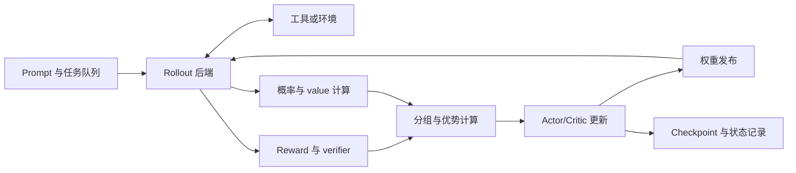

# RL Infra：架构、数据一致性、异步与恢复

[讲解总目录](README.md)

<!-- chapter-meta:start -->
本章关联 **25 道题**，按知识点合并讲解，跨章可重复关联。以下为最新样本的宽主题频次，不是细题命中概率。

| 主要考点 | 牛客（13帖） | 小红书（17帖） | 知乎（11帖） |
| --- | --- | --- | --- |
| verl / TRL / slime 等训练框架 | 中 2/13 | 高 7/17 | 中 2/11 |
| on-policy / off-policy 与策略差异 | 低 1/13 | 高 5/17 | 中 2/11 |
| RL 多模型共卡 / 分卡部署 | 未观察到 0/13 | 低 1/17 | 未观察到 0/11 |
| RL 阶段耗时、吞吐与利用率 | 未观察到 0/13 | 中 3/17 | 低 1/11 |

高 ≥4 帖、中 2–3、低 1；岗位优先级见原题。统计与来源见 [全网台账](../面试题库/08-全网来源与考频.md)。
<!-- chapter-meta:end -->

RL 系统既要高效生产经验，也要保证优化器使用的每条经验仍有明确含义。最重要的系统不变量是：token、概率、奖励、优势和版本必须对应同一条真实轨迹。

<a id="architecture"></a>

## 1. 从一次迭代画出服务与数据流

<!-- q: I01 I15 I19 -->

<!-- question-links:start -->
对应面试题：[I01](../面试题库/05-RL-Infra系统与排障.md#I01)、[I15](../面试题库/05-RL-Infra系统与排障.md#I15)、[I19](../面试题库/05-RL-Infra系统与排障.md#I19)。
<!-- question-links:end -->



对 GRPO，P 节点可能只需要相应的概率，且没有 critic；对 PPO，需要 value 及其训练目标。框图表示职责，不意味着每个方框都需要独立机器或常驻完整模型。HybridFlow 等系统的核心问题之一就是如何把多模型数据流与不同阶段的分布式计算组织起来。[HybridFlow](https://arxiv.org/abs/2409.19256)

面对“64 张卡怎么设计”，先询问模型、上下文/输出长度分布、G、奖励成本、网络、目标质量与可接受延迟。先给 trainer、rollout、reward/reference 各阶段测得的容量，再分配卡数。一个 32/24/8 的资源草案只表示预算分组；未检查模型能否放下、TP/DP 整除与通信组，就不能当成可运行方案。

以每个已验证 group 为统一单位，若生成端 3 group/s，训练端 2 group/s，长期队列就会增长。给生成端继续加卡不会提高稳态完成速度。比较容量时要统一长度、组大小、过滤与失败处理，避免一个服务报 token/s，另一个报 batch/s，却直接拿来做平衡。

Ray actor、进程和协程是组织并发的机制。GPU worker 执行模型计算，CPU worker 管理环境与验证，协调器负责版本和流控。一个协程异步等待网络，并不代表 CPU 密集计算自动并行；大型张量在进程间传递的复制和对象存储成本也必须测量。

<a id="colocation"></a>

## 2. 共卡与分卡要比较完整周期

<!-- q: I02 I10 -->

<!-- question-links:start -->
对应面试题：[I02](../面试题库/05-RL-Infra系统与排障.md#I02)、[I10](../面试题库/05-RL-Infra系统与排障.md#I10)。
<!-- question-links:end -->

共卡可让同一批 GPU 在生成和训练阶段切换，减少某些阶段的资源闲置；代价可能是模型卸载/重载、内存池切换、权重布局转换和阶段屏障。分卡可重叠生成与更新，但需要资源配比、通信和对旧样本的算法处理。

假设在某套固定资源上，一个同步周期需要生成 12 秒、评分 2 秒、训练 6 秒、同步 1 秒，总计 21 秒。如果这些阶段在不同资源上可以流水化且容量保持不变，理想稳态下界由最慢的 12 秒阶段主导；实际还受填充、同步、队列和策略滞后影响。这个例子说明优化应看整周期，而不是保证某种拆卡方式一定得到 21/12 倍收益。

Rollout tokens/s 提高但训练更慢，可能是生成更长、无效组更多、奖励服务排队、权重更陈旧，或为了推理 batch 挤占了训练显存。建议同时报告有效经验 token/s、验证成功样本/s、更新吞吐和达到固定质量所需时间。

<a id="weight-sync"></a>

## 3. FSDP/ZeRO 到 TP 的权重同步

<!-- q: I03 I04 -->

<!-- question-links:start -->
对应面试题：[I03](../面试题库/05-RL-Infra系统与排障.md#I03)、[I04](../面试题库/05-RL-Infra系统与排障.md#I04)。
<!-- question-links:end -->

训练参数分片与推理参数分片可能不是同一种切法。以数学矩阵 `[out,in]` 为例，训练端可能按扁平参数存储分片，推理端按输出或输入通道分片，还可能将 Q/K/V 合并、转置或量化。因此同步需要逻辑参数名、全局形状、分片范围、dtype 和转换规则，不能只广播一段不带语义的内存。

下面是一种可审查的发布协议，属于工程设计示例：

1. Trainer 完成本次 optimizer step，生成不可变版本号与参数 manifest。
2. 各推理 worker 将新分片加载到待发布缓冲，完成布局/量化转换。
3. 校验分片完整性、参数结构和必要的数值校验，全部 worker 回报就绪。
4. 在请求边界按版本切换；在途请求采用完成旧版、取消重跑或明确的分段策略。
5. 记录切换完成与失败处理，之后才回收旧缓冲。

这个方案的双缓冲可能放不下，需要用阶段停机、分批重建或其他机制换空间。无论具体实现如何，都应禁止一个 forward 同时读取未定义的新旧参数组合。TP 组内也必须对版本切换一致，单个 worker “已更新”不够。

对于 MoE、量化和 adapter，manifest 还要覆盖专家映射、scale、adapter/base 版本等派生状态。只校验原始 FP 权重，可能漏掉已经失配的推理缓存或量化元数据。

<a id="logprob"></a>

## 4. 相同权重为什么还有训推偏差

<!-- q: I05 I23 E42 E43 -->

<!-- question-links:start -->
对应面试题：[I05](../面试题库/05-RL-Infra系统与排障.md#I05)、[I23](../面试题库/05-RL-Infra系统与排障.md#I23)、[E42](../面试题库/11-全网扩展-RLInfra与手撕.md#E42)、[E43](../面试题库/11-全网扩展-RLInfra与手撕.md#E43)。
<!-- question-links:end -->

可以按成本从低到高排查：token ID 与模板 → attention/action mask → position ID 与缓存位置 → 采样变换 → dtype/量化 → kernel 与归约顺序 → MoE 路由。先固定同一批输入和相同权重逐层比较，再讨论分布式异步带来的版本差异。[verl rollout correction](https://verl.readthedocs.io/en/latest/algo/rollout_corr.html)

固定 seed 主要固定随机数流；确定性算子要求在其承诺范围内重复得到相同结果；batch invariance 则要求请求输出不因同批其他请求改变而变化。这三个保证不同。改变 batch shape 后选择了另一个 GEMM kernel，即使没有显式随机操作，也可能改变归约和舍入。[vLLM 可复现性](https://docs.vllm.ai/en/stable/usage/reproducibility/)

MoE 会放大小数值差异：router 的两个候选分数很接近时，一点扰动可能改变 top-k expert，从而让后续计算路径不同。Router Replay 可记录某阶段路由并在相应训练计算中重放，减少这一类路径差异；它不自动修复 attention mask、采样分布或参数版本错误。应说明框架版本、记录的是哪些路由决策以及重放范围。

Split-K 将 GEMM 的 K 维计算分到多个任务后再合并结果，有助于小 M 等并行度不足的场景，但归约组织可能影响数值行为。关闭后变慢，应在 shape 分布、tile 和归约确定性之间寻找配置；不能把“关闭一个优化”当永久的性能方案。

<a id="async"></a>

## 5. 异步 rollout：背压、版本滞后与 partial rollout

<!-- q: I06 I07 I08 E48 -->

<!-- question-links:start -->
对应面试题：[I06](../面试题库/05-RL-Infra系统与排障.md#I06)、[I07](../面试题库/05-RL-Infra系统与排障.md#I07)、[I08](../面试题库/05-RL-Infra系统与排障.md#I08)、[E48](../面试题库/11-全网扩展-RLInfra与手撕.md#E48)。
<!-- question-links:end -->

异步系统让生产经验与更新策略重叠，减少等待，但训练消费的数据可能由旧权重生成。Version lag 可以定义为当前 learner 版本减行为版本；它只是一种代理，两个相邻版本也可能变化很大，所以还要观察概率比率、KL、clip 和质量。[AReaL](https://arxiv.org/abs/2505.24298)

经验队列建议同时有三个限额：样本/group 数限制调度对象数量；token 数限制内存与计算成本；最大策略滞后限制数据陈旧程度。只限 1000 条样本，无法区分每条 100 token 与 10,000 token 的负载。

一个最小轨迹记录可包含：

```json
{
  "sample_id": "稳定且可去重的ID",
  "prompt_id": "任务ID",
  "group_id": "同一组采样ID",
  "behavior_version": 42,
  "sampling_config_id": "固定采样定义",
  "reward_version": "verifier-v3",
  "token_ids": [],
  "action_mask": [],
  "behavior_log_probs": [],
  "termination_reason": "eos"
}
```

GRPO 应维护完整 group 的成员关系；超时缺一个回答时，是重采、丢组还是改变组大小，应有明确策略。按完成先后截断队列可能偏向短任务，因而背压和淘汰也会改变学习分布。

Partial rollout 将长任务分段生产或续跑。如果中途切策略，整条轨迹可能不再来自单一 pi_rollout，需要记录每段甚至每个动作的版本/概率。续跑还需要正确的环境状态、前缀、KV 处理和奖励累计语义。不能只把 `max_new_tokens` 改小就视为支持了 partial rollout。

<a id="normalization"></a>

## 6. 变长、多卡与全局 loss 的正确归一化

<!-- q: I12 I13 E41 C08 -->

<!-- question-links:start -->
对应面试题：[I12](../面试题库/05-RL-Infra系统与排障.md#I12)、[I13](../面试题库/05-RL-Infra系统与排障.md#I13)、[E41](../面试题库/11-全网扩展-RLInfra与手撕.md#E41)、[C08](../面试题库/06-手撕与白板练习.md#C08)。
<!-- question-links:end -->

设 rank r 的有效 token loss 总和为 S_r，数量为 n_r，全局目标是 `L=sum S_r / N`，其中 `N=sum n_r`。若 DDP 默认对 W 个 rank 的梯度平均，则可让每个 rank backward：

```text
L_local = W * S_r / N
```

因为 DDP 最后再除以 W，得到 `sum grad(S_r)/N`。如果本地先除 n_r，就会让 token 较少的 rank 获得相同总权重。

例：rank0 有 2 个 token、loss 总和 2；rank1 有 8 个 token、loss 总和 24。全局 token mean 是 26/10=2.6，局部 mean 再平均却是 `(1+3)/2=2`。差别不仅是日志，也可能改变梯度权重。

这个推导假设实际梯度归约为平均、分母是与模型参数无关的有效数量。若用了自定义通信 hook、梯度累积或其他并行库，要先确认其缩放语义。跨多个 micro-batch 的目标也应使用整次更新的全局分母或等价调整，而不是无条件平均每个 micro-batch。

用于日志的 detached SUM/AVG 与参与 autograd 的 loss collective 要分开。重复 all-reduce 一个指标可能只使日志错误；重复归约带梯度的张量，则取决于算子的 autograd 语义改变训练。没有有效 token 的 rank 仍需要按设计参加 collective，不能擅自跳过 backward。

Packing、长度排序、SP/CP 转换都可能重排 token。稳定 sample/group ID、原始长度、动作 mask 和排列逆映射应一起传递。检查时用不同样本的可识别 reward 和不同长度，容易发现“shape 正确但对应关系错了”的 bug。

<a id="recovery"></a>

## 7. Verifier、环境与 checkpoint 的恢复语义

<!-- q: I16 I17 I18 I21 E49 -->

<!-- question-links:start -->
对应面试题：[I16](../面试题库/05-RL-Infra系统与排障.md#I16)、[I17](../面试题库/05-RL-Infra系统与排障.md#I17)、[I18](../面试题库/05-RL-Infra系统与排障.md#I18)、[I21](../面试题库/05-RL-Infra系统与排障.md#I21)、[E49](../面试题库/11-全网扩展-RLInfra与手撕.md#E49)。
<!-- question-links:end -->

Verifier 超时、解析失败与回答错误不是同一种失败。若把基础设施故障都记成任务 reward=0，系统不稳定会变成错误的训练信号。应保存原始结果、失败类别、重试次数和版本；只在任务定义明确时将某种失败映射为奖励。

工具重试需要幂等键或结果缓存。例如创建资源的调用超时，可能已经执行成功但响应丢失，直接重发会重复产生副作用。只要环境不支持可验证的幂等或事务，就不能无条件承诺 exactly-once；可以明确采用 at-least-once 并在任务层去重或补偿。

RL checkpoint 除模型、optimizer、scheduler、RNG 外，还可能包含采样游标、策略版本、经验队列、group 完成状态、已提交 update ID 和环境快照。关键边界是“该批样本是否已参与一次成功提交的参数更新”。若参数已保存却没有保存消费状态，恢复时可能重复训练；反之可能漏掉经验。

一个可行方向是把更新版本、消费 batch ID 与 checkpoint manifest 绑定，并区分已暂存、已更新、已持久化状态。它是应用层一致性协议，不能仅靠某个分布式存储保证自动获得训练事务。对不支持环境快照的外部系统，应明确重放记录和重新执行的区别。[verl Agent Loop](https://verl.readthedocs.io/en/latest/advance/agent_loop.html)

<a id="scheduling"></a>

## 8. 空闲 GPU 多也可能调度失败

<!-- q: E53 -->

<!-- question-links:start -->
对应面试题：[E53](../面试题库/11-全网扩展-RLInfra与手撕.md#E53)。
<!-- question-links:end -->

16 卡训练可能要求同时获得两台各 8 卡同型号节点，而集群空闲的 32 张卡散落在很多机器。Gang scheduling、拓扑亲和、配额和故障域约束使“空闲卡总数”不足以判断可调度性。Ray placement group 提供资源组的原子预留与布局策略，但资源请求还需与实际 worker 一致。[Ray Placement Groups](https://docs.ray.io/en/latest/ray-core/scheduling/placement-group.html)

应记录不可调度的具体约束，再比较等待、抢占或重布局的代价。改变 TP/PP 度可能让作业放得下，却引入通信和 checkpoint 重分片成本。调度决策的目标应是有效任务完成，而非单纯提高集群 GPU 占用百分比。

## 本章面试表达练习

设计一个异步 GRPO 作业，要求一次 worker 故障后可恢复。明确写出权重发布、group 入队、样本消费和 checkpoint 提交四个边界，并指出哪个指标能发现版本错配、重复消费或长任务饥饿。
